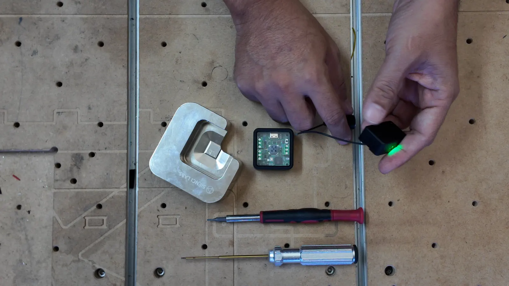
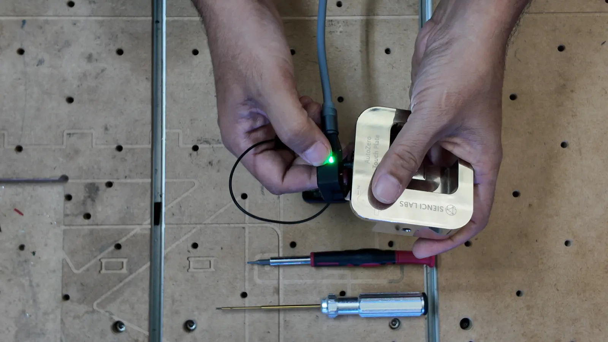
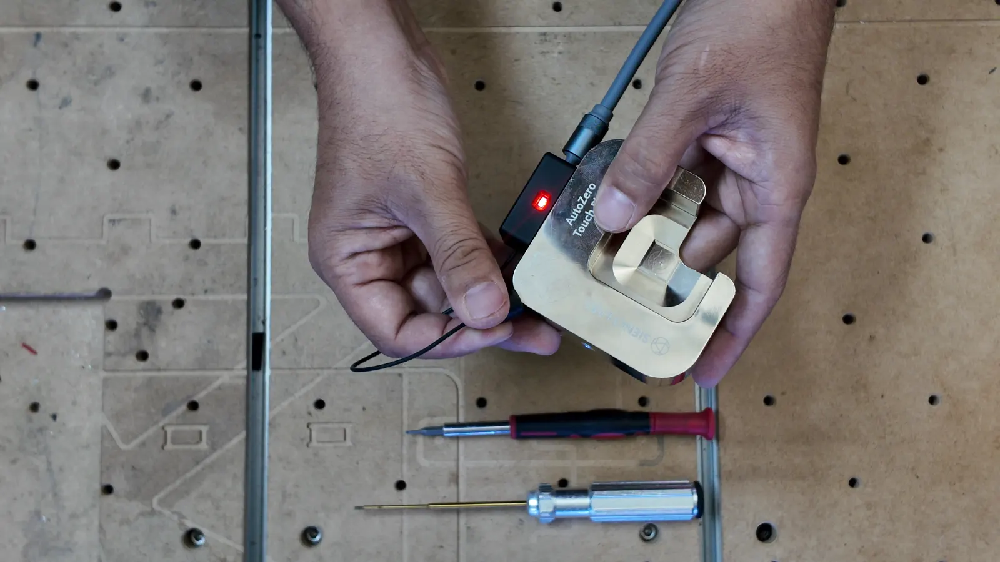
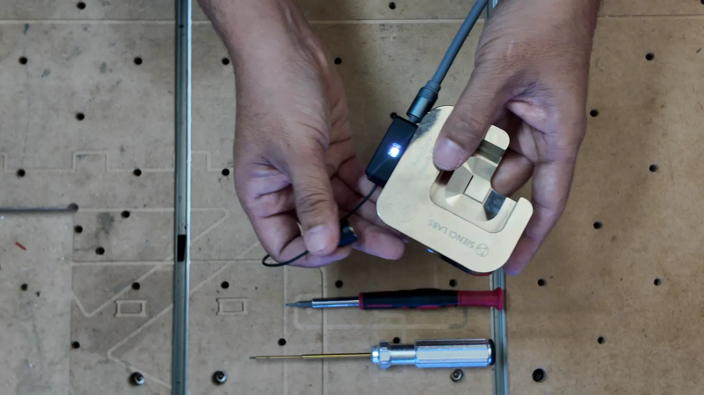
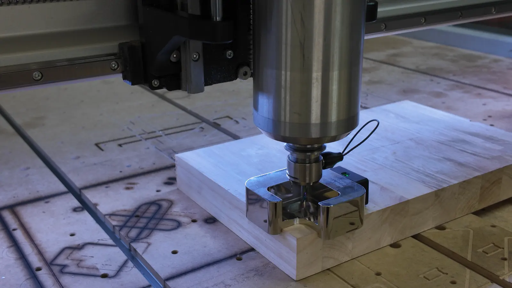
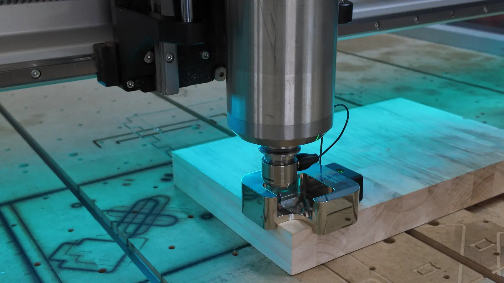
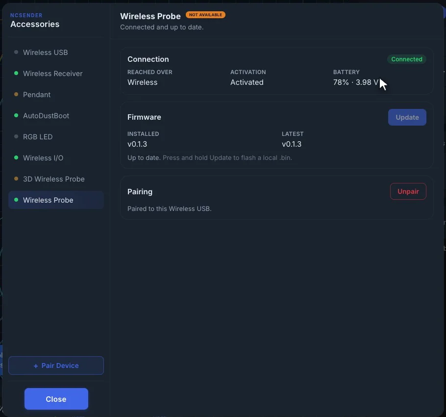

# AutoZeroAir

The AutoZeroAir makes the AutoZero touch plate wireless. A small transmitter
sits on the side of the plate and sends every touch to the
[Wireless Receiver &rarr;](wireless-receiver.md), which passes it to your
controller's probe input. No wire runs to the plate.

Because the receiver is wired to the controller, the AutoZeroAir works with
any sender, not only ncSender.

[Get the AutoZeroAir &rarr;](https://www.franciscreation.com/p/autozeroair)

!!! tip "Video"
    [AutoZeroAir: a wireless AutoZero &rarr;](https://youtu.be/pa_RbBBPcF0)

## In the kit

- **AutoZeroAir transmitter**, which goes on the AutoZero touch plate. It
  has a magnet on a short wire, which clips onto the bit.
- **Wireless Receiver**. See [Wireless Receiver &rarr;](wireless-receiver.md).

You also need a small flat screwdriver for the receiver's terminal block, and
a pick or other pointy tool for the receiver's pairing button. With ncSender
the pick is optional: you can start pairing from **Accessories**.

## Charge it first

When it arrives, **plug the transmitter into USB-C power**. Moving or shaking
wakes it, so it may have stayed awake during shipping and arrive with a low
battery.

While it charges, try it: touch the magnet to the plate. The light turns
**red**. That's a contact.

## Pairing

The transmitter pairs to the [Wireless Receiver &rarr;](wireless-receiver.md).

1. **Put the transmitter into pairing mode.** Touch the magnet to the plate
   **three times quickly**, then touch it a **fourth time and hold it for
   5 seconds**.

    

2. The light **blinks white**: the transmitter is looking for a receiver. It
   keeps looking until it pairs.

    

3. **Open the receiver's pairing window.** Press and hold the receiver's
   pairing button with the pick for **3 seconds**, or, with ncSender, click
   **Pair Device** in **Accessories**. The window stays open for
   **60 seconds**.
4. The transmitter's light turns **green**. They're paired.

## Test it

Touch the magnet to the plate. The receiver lights red and beeps, and your
controller shows the probe pin triggered. If it shows triggered while nothing
is touching, invert the probe input: see
[Probe invert &rarr;](wireless-receiver.md#probe-invert).

## Probing

1. **Wake the transmitter**: pick up the plate or give it a shake. Wait for
   the green light.
2. Set the plate on the corner of your stock.
3. Jog the bit over the middle of the plate and lower it into the hole.
4. **Clip the magnet onto the bit.** Touch it to the plate once to check for
   the beep.
5. Start the **AutoZero** probe. In ncSender, see
   [AutoZero Touch &rarr;](../features/probing.md#autozero-touch).

## Sleep and wake

- **On battery, it sleeps after 2 minutes without use.** In the last
  30 seconds the light blinks **orange** to warn you, faster in the last
  10 seconds.
- **On USB power it never sleeps.**
- **To wake it, pick it up or give it a shake.** Plugging in USB also wakes
  it.
- **Touching the plate does not wake it.** Always wake it before you probe.

Any touch, movement or button press restarts the 2 minutes. Holding the
magnet on the plate does not keep it awake.

## Light

| Light | Meaning |
|---|---|
| Green | Connected to the receiver, ready |
| Yellow | On, but not connected to a receiver |
| Red | Contact: the magnet is touching the plate |
| White blink | Pairing mode |
| Orange blink | About to sleep |
| Slow red blink | Battery low, or locked out (see below) |
| Fast red blink | Not activated |
| Blue blink | Firmware update in progress |
| Off | Asleep |

There is no separate charging light.

## Battery

- **Low battery:** below about 3.5 V the light blinks red slowly. Charge it
  soon.
- **Lockout:** below about 3.4 V the transmitter **reports a contact** on
  purpose, so a probe move stops right away instead of driving the bit into
  the plate. Charging clears it.

In ncSender, the battery is shown in **Accessories → Wireless Probe**, for
example *78% · 3.98 V*, or *Charging* while on USB.

{ .center width="520" }

## In ncSender

The AutoZeroAir is listed in **Accessories** as **Wireless Probe**. There you
can see its connection and battery, update its firmware, and unpair it.

- **Firmware updates:** select **Wireless Probe** and click **Update to v…**.
  It updates over USB if it is plugged in, otherwise wirelessly. It stays
  awake while it updates. See
  [Updating firmware &rarr;](wireless-usb.md#updating-firmware).
- The transmitter must be awake to show as **Connected**.
