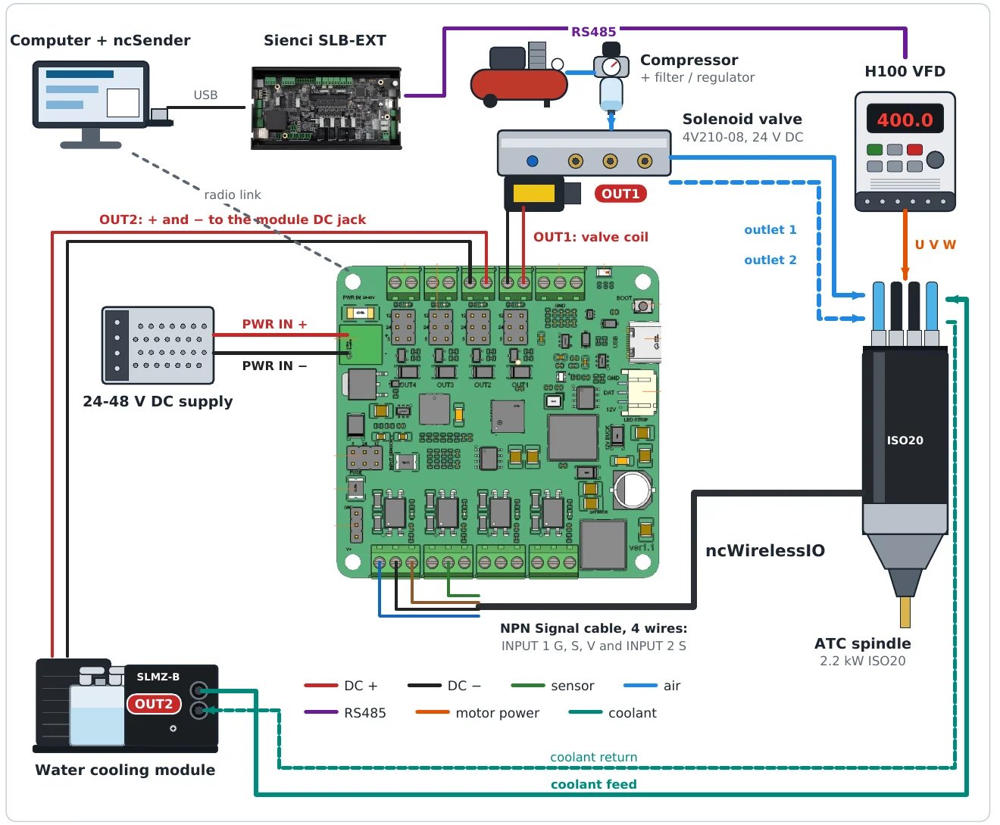

# User guide: Water-cooled Pneumatic ATC

!!! note "Contributed by a user"
    This guide was written by an ncSender user for their own machine. It is
    shared as a worked example. Check every value against your own spindle,
    VFD and controller manuals before you use it.

A complete set-up of a water-cooled pneumatic ATC spindle run by ncSender
through the [ncWirelessIO &rarr;](ncwirelessio.md): wiring, air lines,
cooling loop, VFD settings and the
[Pneumatic ATC &rarr;](../plugins/pneumatic-atc.md) plugin settings.

[Download the guide (PDF, 9 pages) &rarr;](../assets/guides/water-cooled-pneumatic-atc.pdf){ .md-button }

## The set-up

| Part | Used here |
|---|---|
| Spindle | G-Penny 2.2 kW ISO20 water-cooled ATC spindle, 220 V, 24,000 rpm (2-pole 400 Hz or 4-pole 800 Hz) |
| VFD | H100, over RS485 (Modbus) |
| Controller | Sienci SLB-EXT (grblHAL) |
| Wireless I/O | ncWirelessIO: **OUT1** solenoid valve, **OUT2** cooling module, **INPUT 1** and **INPUT 2** spindle sensors |
| Valve | 4V210-08 solenoid valve, 24 V DC coil |
| Cooling | SLMZ-B water cooling module, powered straight from OUT2 |

## What's in the guide

1. **How to set up the ATC spindle:** the whole system and the parts list.
2. **Cooling loop:** hoses, quick-disconnects, filling, and powering the
   module from OUT2.
3. **Air lines:** compressor to valve, and which valve outlet goes to Tool
   Change, De-dusting and Air Seal.
4. **Spindle top plate and plugs:** every port, and the power and sensor
   plug pin-outs.
5. **Wiring the ncWirelessIO:** jumpers first, then power, OUT1, OUT2 and the
   NPN sensor plug.
6. **Wiring the H100 VFD to the SLB-EXT:** mains (USA and Europe), motor
   plug, RS485.
7. **H100 VFD settings** for both spindle options.
8. **SLB-EXT settings and speed check.**
9. **ncSender settings:** pairing the ncWirelessIO and setting up the
   Pneumatic ATC plugin.

For the ncWirelessIO itself (jumpers, outputs, inputs, roles), see
[ncWirelessIO &rarr;](ncwirelessio.md).
