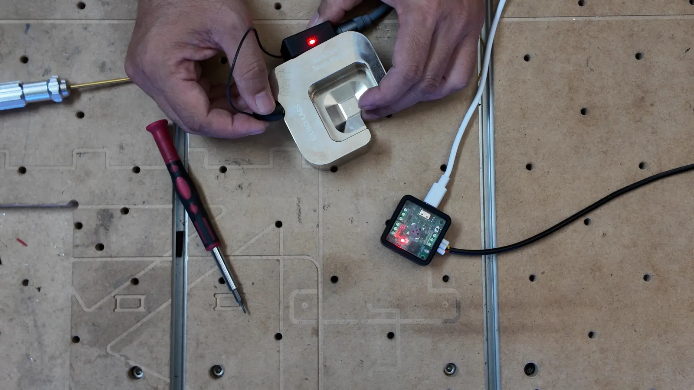
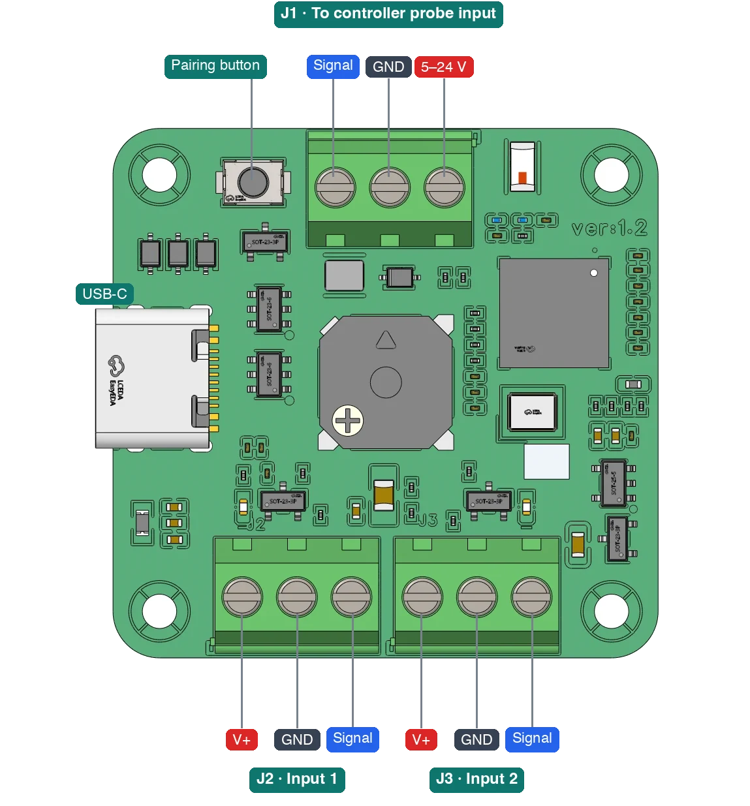
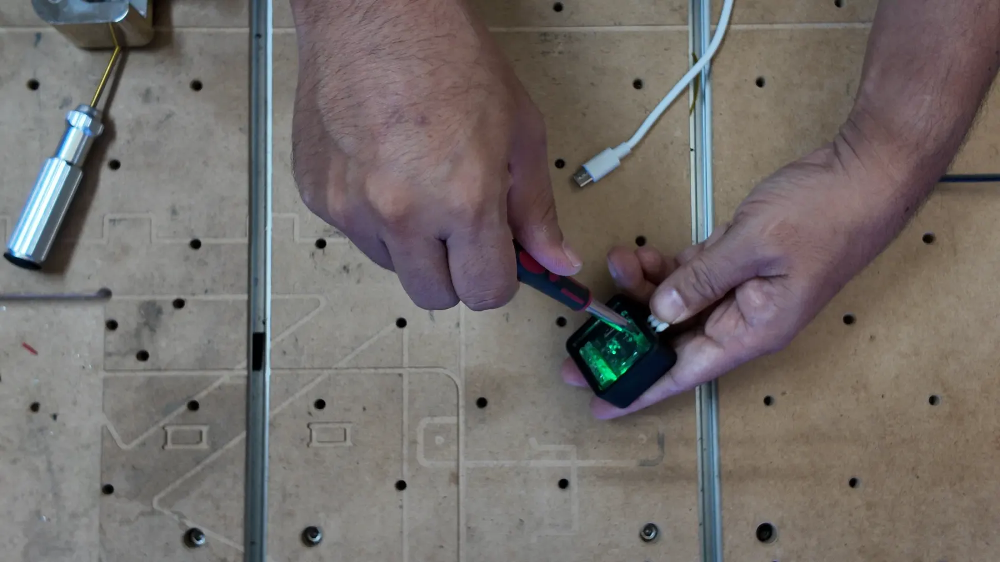
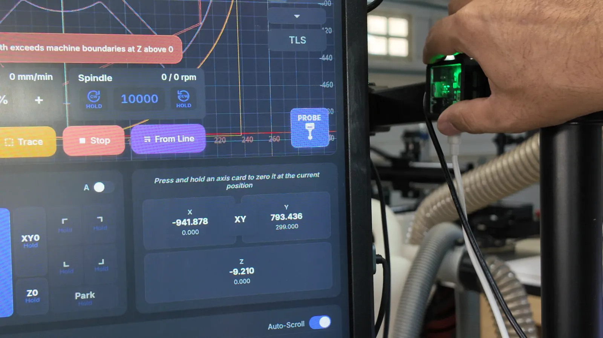
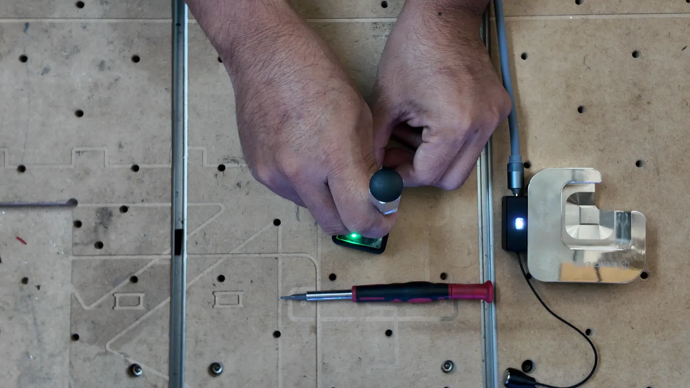
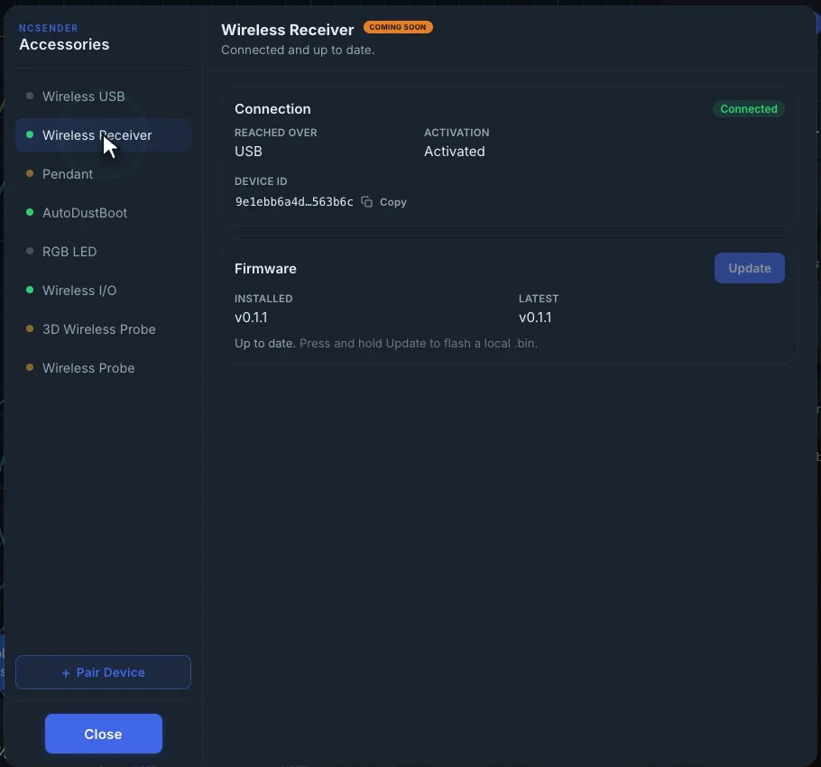

# Wireless Receiver

The Wireless Receiver (Wireless RX) receives the touches from a wireless probe,
such as the [AutoZeroAir &rarr;](autozeroair.md), and passes them to your CNC
controller's probe input over a short wire. Your controller sees a normal
probe input, so the probe works with any sender: ncSender, gSender or others.

With ncSender, the receiver also replaces the
[Wireless USB &rarr;](wireless-usb.md): the Pendant, AutoDustBoot, RGB LED and
Wireless I/O pair to it the same way.

## What you need

- A **small flat screwdriver** for the terminal block.
- A **pick or other pointy tool** to press the pairing button. With ncSender,
  you can start pairing from **Accessories** instead.
- A free **probe** or **toolsetter** input on your controller, with a
  **5–24 V** supply next to it.
- For ncSender: a **USB cable** to the computer running ncSender.

## Connectors

{ .center width="560" }

| Connector | Pins (left to right, as pictured) | Use |
|---|---|---|
| **J1** (top) | Signal · GND · 5–24 V | To the controller's probe or toolsetter input |
| **J2** (bottom left) | V+ · GND · Signal | Input 1, a wired sensor (optional) |
| **J3** (bottom right) | V+ · GND · Signal | Input 2, a wired sensor (optional) |
| **USB-C** | | To the computer running ncSender (optional) |
| **Pairing button** | | Hold 3 s to open the pairing window |

## Wiring

Wire **J1** to your controller with three wires:

| J1 pin | Goes to |
|---|---|
| **5–24 V** | The controller's supply for the probe port |
| **GND** | The controller's ground |
| **Signal** | The controller's probe or toolsetter input |

1. Slide each wire into the terminal block.
2. Tighten each screw with the flat screwdriver.
3. Give each wire a gentle tug to check it holds.
4. Plug the terminal block into the receiver.

Check your controller's manual for the pin order of its probe port.

### Wired sensor inputs

**J2** and **J3** take an extra wired sensor each, such as a wired touch
plate or toolsetter. A trigger on either input, or on the wireless probe,
triggers **J1**, so they share the one controller input.

- **V+** is the same 5–24 V that powers the receiver, for the sensor's supply.
- **Signal** accepts 3.3–24 V. A high signal counts as triggered; an
  unconnected input reads as not triggered.
- A blue light next to the inputs lights while each input is triggered.

The receiver is powered from the controller. USB is only needed for ncSender.

### Probe invert

The receiver's output is open-drain and **normally closed**: it holds the
signal low at rest and releases it on contact. Most controllers then need the
probe input inverted.

Touch the magnet to the plate and watch your controller's probe pin. If it
shows triggered while nothing is touching, invert the probe input. In
ncSender, turn on **Invert** for the **Probe** row (or **Toolsetter**, if you
wired that input) in the Setup Wizard's
[Switches & probe &rarr;](../getting-started/setup-wizard.md#switches-probe)
step. In another sender, use its probe invert setting.

## Where to mount it

Mount the receiver **up high, with a clear view of the machine**, for
example on the arm of the ncSender screen. Don't put it behind the controller
box or inside a metal enclosure: metal blocks the radio.

## Pairing

The receiver must be powered to pair.

**With the button:**

1. Put the probe into pairing mode. For the AutoZeroAir, see
   [Pairing &rarr;](autozeroair.md#pairing).
2. On the receiver, press and hold the pairing button with the pick for
   **3 seconds**. The pairing window stays open for **60 seconds**.
3. The probe's light turns green when it's paired.

**From ncSender:** open **Accessories** and click **Pair Device**. It opens the
same 60-second window. See
[Pairing a new device &rarr;](wireless-usb.md#pairing-a-new-device).

## Replacing the Wireless USB

If you already use the ncSender Wireless USB:

- **Only one can be connected.** Unplug the Wireless USB and plug in the
  receiver.
- **Pair your accessories again.** They were paired to the Wireless USB, not
  to the receiver. Pair the Pendant, AutoDustBoot, RGB LED and Wireless I/O
  one by one, as described in
  [Pairing a new device &rarr;](wireless-usb.md#pairing-a-new-device).

{ .center width="520" }

The receiver holds up to 8 paired devices. In **Accessories**, the Pairing
card of a device paired to it still reads *Paired to this Wireless USB.*

## Light and beep

| Light | Meaning |
|---|---|
| Solid red | Probe contact |
| Fast red blink | Fail-safe: the probe in use went quiet (see below) |
| Green | An accessory is connected |
| Blue | Paired, but nothing is connected right now |
| White blink | Pairing window open, or nothing paired yet |
| Slow red blink | Not activated |
| Blue blink | Firmware update in progress |

On every contact the receiver **beeps**, and gives a lower beep on release.
The beep only sounds while it is connected to ncSender over USB.

## Fail-safe

If the probe in use goes quiet for **3 seconds**, for example out of range or
with a flat battery, the receiver reports a **contact**. A probe move then
stops instead of driving the bit into the plate. When the probe goes to
sleep, it tells the receiver first, so a sleeping probe does not trigger the
fail-safe.

## Firmware updates

With ncSender, update the receiver from **Accessories**: select **Wireless
Receiver** and click **Update to v…** in the Firmware card. It updates over
its USB cable. See
[Updating firmware &rarr;](wireless-usb.md#updating-firmware).
