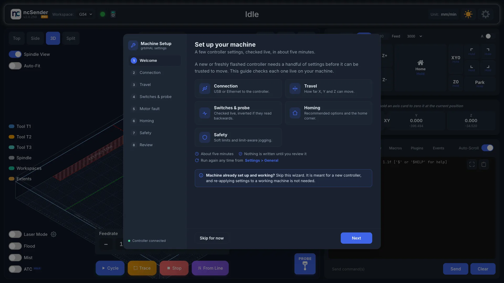

# Installation



## Downloads

### Community Edition (Free)

Download the latest release from [GitHub Releases](https://github.com/siganberg/ncSender/releases).

| Platform | Download |
|----------|----------|
| Windows x64 | `.exe` installer |
| macOS (Apple Silicon) | `.dmg` |
| macOS (Intel) | `.dmg` |
| Linux x64 | `.deb` |
| Linux ARM64 (Raspberry Pi) | `.deb` |

### Pro Edition

Download from [ncSender Pro Releases](https://github.com/siganberg/ncsenderpro.releases/releases).

After installing, see [License Activation](license-activation.md) to unlock the Pro features with your Installation ID.

## System Requirements

- **Windows**: Windows 10 or later (x64)
- **macOS**: macOS 12 Monterey or later (Apple Silicon and Intel)
- **Linux**: Ubuntu 22.04+ or Debian 12+ (x64 and ARM64)

## Installation Steps

=== "Windows"

    1. Download the `.exe` installer:
       [Community](https://github.com/siganberg/ncSender/releases/latest) ·
       [Pro](https://github.com/siganberg/ncsenderpro.releases/releases/latest)
    2. Run the installer and follow the prompts. Keep the suggested install
       folder unless you have a reason to change it; in-app updates then run
       without asking for administrator rights.
    3. Launch ncSender from the Start menu

=== "macOS"

    1. Download the `.dmg` file (Apple Silicon or Intel build):
       [Community](https://github.com/siganberg/ncSender/releases/latest) ·
       [Pro](https://github.com/siganberg/ncsenderpro.releases/releases/latest)
    2. Open the DMG and drag ncSender to Applications
    3. Before the first launch, clear the quarantine attribute:
    ```bash
    xattr -c /Applications/ncSender.app
    ```
    On **Pro**, this is a one-time step: later versions installed through the
    app's own [updater](software-updates.md) don't need it. The Community
    edition does not install updates on macOS, so run this command again after
    each manual install.

=== "Linux"

    1. Download the `.deb` package (x64 or ARM64):
       [Community](https://github.com/siganberg/ncSender/releases/latest) ·
       [Pro](https://github.com/siganberg/ncsenderpro.releases/releases/latest)
    2. Install: `sudo dpkg -i ncSender_*.deb`
    3. Launch from the application menu or run `ncsender`

=== "ncSenderOS (x64 PC / Raspberry Pi 5)"

    !!! info "Pro Feature"
        ncSenderOS ships with **ncSender Pro** only.

    A ready-made system that boots straight into ncSender Pro. Use the ISO
    for an x64 PC, or the SD-card image for a Raspberry Pi 5. See
    [Installing ncSenderOS](ncsenderos.md) for the step-by-step guide.

## What Happens on First Launch

1. **Pro only:** the **License Required** screen asks for your Installation ID.
   See [License Activation](license-activation.md).
2. The [Machine Setup Wizard](setup-wizard.md) opens. It sets up the
   connection and checks your controller settings. If your machine already
   works, click **Skip for now**.
3. From the second launch on, a [Tips & Tricks](tips-and-tricks.md) dialog
   shows a short tip. You can turn it off.

## Updating Later

New versions can install from inside the app:

- **Pro:** Windows, macOS and Debian-based Linux.
- **Community:** Debian-based Linux only. On Windows and macOS, download and
  install the new version yourself.

See [Software Updates](software-updates.md).
